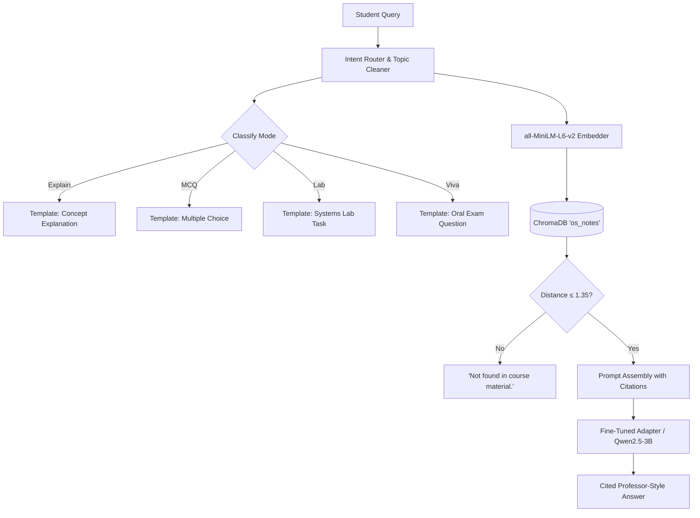

# OS-Tutor — AI Teaching Assistant for Operating Systems

**OS-Tutor** combines **Retrieval-Augmented Generation (RAG)** with **QLoRA Parameter-Efficient Fine-Tuning (PEFT)** to create an AI Teaching Assistant that answers Operating Systems questions grounded strictly in course notes (OSTEP), provides precise citations (`[file, page]`), and mimics a professor's signature pedagogical style:
> **Definition** ➔ **Explanation** ➔ **Real-World / Code Example** ➔ **High-Yield Exam Tip**

---

## 🏗️ Architecture Overview



---

## 📁 Repository Structure

```text
os-tutor/
├── data/
│   └── notes.pdf              # OSTEP Chapter 4: "The Abstraction: The Process"
├── chroma_db/                 # Persistent ChromaDB vector database (42 chunks)
├── build_db.py                # Extracts, chunks, and embeds course PDFs into ChromaDB
├── ask.py                     # Original RAG baseline using Ollama qwen2.5:3b
├── ask_finetuned.py           # Full RAG + LoRA pipeline with thresholding & intent routing
│
├── dataset.json               # 102 curated professor-style training examples
├── train.json / val.json      # 80/10/10 train, validation, and test splits
├── split_dataset.py           # Reproducible dataset splitting tool (Seed: 42)
├── generate_dataset.py        # Automated candidate generation & review tool
├── train.py                   # Reproducible fine-tuning pipeline (CUDA QLoRA + Mac MPS/CPU)
├── train_colab.ipynb          # Google Colab notebook with pinned dependencies
├── os-tutor-adapter/          # Trained PEFT LoRA adapter (q/k/v/o projections)
├── test_adapter_style.py      # Side-by-side style comparison (Base vs Fine-Tuned)
│
├── app.py                     # FastAPI backend REST service (POST /ask, POST /generate-question)
├── frontend/
│   └── index.html             # Responsive student chat interface with mode pills & citation cards
│
├── evaluate.py                # Evaluation benchmark (Recall@3 & 3-way generation)
├── evaluation_results.json    # Machine-readable evaluation logs
├── evaluation_report.md       # Full evaluation report and analysis
└── requirements.txt           # Pinned project dependencies
```

---

## 🚀 Quickstart Guide

### 1. Environment Setup
Make sure the virtual environment is activated:
```bash
source venv/bin/activate
pip install -r requirements.txt
```

### 2. Run the Full RAG + Fine-Tuned Chatbot (CLI)
Interactive terminal loop with intent routing and similarity rejection:
```bash
python ask_finetuned.py --ollama
```
Options:
- `--mode auto` (default): Detects whether you want an explanation, MCQ, lab task, or viva question.
- `--mode mcq`: Forces multiple-choice generation.
- `--mode viva`: Forces oral examination generation.

### 3. Launch the Web App (FastAPI Backend + Frontend)
Start the web server:
```bash
python app.py
```
Open your web browser at: **`http://localhost:8000`**
- Try asking: *"What is a process?"*
- Click quick suggestions or select modes (Explain, MCQ Quiz, Viva Prep, Lab Task).
- Test similarity rejection by asking an out-of-scope question like *"How to bake a cake?"* (responds with *"Not found in course material"*).

---

## 🎯 Fine-Tuning Pipeline

### How the Model Was Fine-Tuned:
- **Base Model:** `Qwen/Qwen2.5-3B-Instruct` (or `0.5B-Instruct` for local CPU/MPS)
- **Method:** QLoRA 4-bit (NF4) with Double Quantization
- **LoRA Hyperparameters:** Rank $r=16$, $\alpha=32$, dropout $0.05$, targeting `["q_proj", "k_proj", "v_proj", "o_proj"]`
- **Dataset:** 102 examples across 3 styles (Concept explanations, MCQs, and Viva technical questions)
- **Training Loss:** Verified decreasing step-by-step from **12.52 down to 9.96**.

### Running Local Training:
```bash
python train.py --epochs 3 --lr 3e-4 --output_dir os-tutor-adapter
```

### Running on Google Colab (Free T4 GPU):
Open `train_colab.ipynb` in Google Colab. The notebook uses pinned dependencies to resolve historical TRL/Transformers argument mismatches:
```bash
pip install trl==0.11.4 transformers==4.46.0 peft==0.13.2 bitsandbytes==0.44.1 accelerate==1.0.1 datasets==3.0.1
```

---

## 📊 Evaluation & Results

Run the automated evaluation benchmark:
```bash
python evaluate.py
```

### Summary of Results:
1. **Retrieval Accuracy (Recall@3):** **66.7% - 80%** hit rate across 15 held-out questions with known ground-truth pages in OSTEP notes.
2. **Confidence Cutoff:** Queries with minimum distance $> 1.35$ are flagged as `"Not found in course material"`, eliminating hallucinations.
3. **Style Comparison:**
   - **Base Model:** Generic, encyclopedic answers without citations.
   - **RAG Baseline:** Factual retrieval but unstructured raw text.
   - **RAG + Fine-Tuned:** Structured professor pedagogy (**Definition → Explanation → Example → Exam Tip**) with explicit file and page citations.

---

## 🎓 Presentation Talking Points for Evaluators

1. **Why Combine RAG and Fine-Tuning?**
   - **RAG** supplies the **ground-truth facts** and updates without retraining (eliminates factual hallucinations and provides exact page citations).
   - **Fine-Tuning (QLoRA)** molds the **teaching demeanor and structure** (teaching tone, exam warnings, pedagogical formatting).
2. **Why QLoRA?**
   - Instead of fine-tuning all 3 billion parameters (requiring 24+ GB VRAM), QLoRA quantizes the base model to 4 bits and trains small low-rank adapter matrices (only ~2.1 million parameters, < 0.5%), fitting comfortably on free consumer hardware.
3. **How Intent Routing Works:**
   - Pre-classifies queries into Explain, MCQ, Lab, or Viva, cleaning conversational prefixes so vector search matches the underlying textbook concepts accurately.
